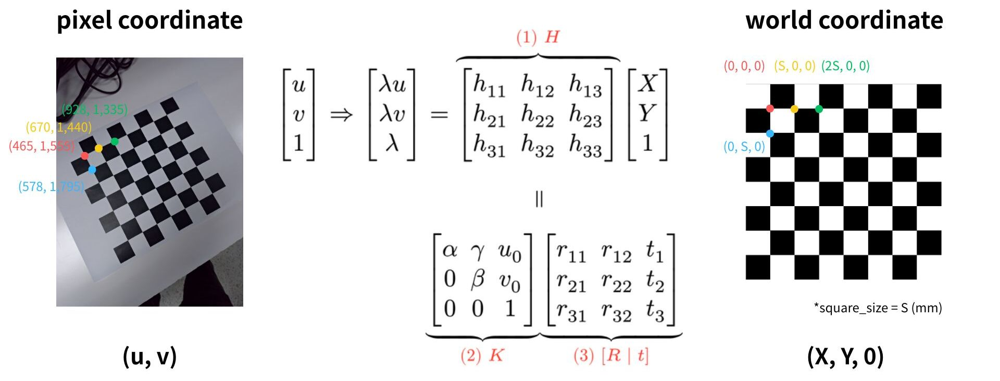

# HW1 - Camera Calibration

## Introduction

This homework implements camera calibration from scratch using the Direct Linear Transform (DLT) and SVD — no `cv2.calibrateCamera`. Given checkerboard images, the pipeline estimates the intrinsic matrix **K** and per-image extrinsics **[R | t]**, then visualizes the camera poses in both world and camera coordinate frames.



## Installation

```bash
conda create -n CV-HW1 python=3.12
conda activate CV-HW1
pip install -r requirements.txt
```

## How to Run

**Static plots** (saved as PNG + displayed with matplotlib):

```bash
python camera_calibration.py
```

Switch between the built-in dataset and custom smartphone photos by editing `DATA_DIR` near the top of the script:

```python
DATA_DIR = 'data'         # built-in checkerboard images
DATA_DIR = 'my_data'  # your own photos
```

**Interactive web viewer** (Dash app at `http://127.0.0.1:8050`):

```bash
python camera_calibration_web.py
```

Two tabs are available — *World Coordinate* (boards fixed, cameras orbit) and *Camera Coordinate* (camera fixed, boards move).
